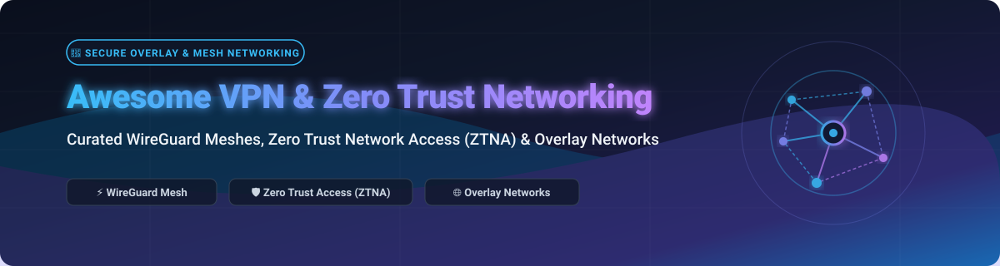

  

# 🛡️ Awesome VPN & Zero Trust Networking 🚀

  
  
  
  
  

---

## 🌐 Top VPN & Zero Trust Networking (ZTNA) Ecosystem

> **A Curated Directory of Commercial SaaS Platforms & Self-Hosted Open-Source GitHub Projects**  
> *Focused on WireGuard Mesh, Zero Trust Network Access (ZTNA), Software-Defined Perimeters (SDP), Overlay Networks & Secure Remote Connectivity.*  
> **📅 Last updated: October 2026**

---

### 📖 SEO & Technology Overview

**VPN and Zero Trust Networking** modernizes how distributed teams, edge devices, cloud servers, and microservices communicate securely across untrusted public networks. 

Traditional enterprise VPNs rely on perimeter-centric, "castle-and-moat" architectures where authenticated users receive broad layer-3 access to an entire private network subnet. In contrast, modern **Zero Trust Network Access (ZTNA)** and **WireGuard-based Overlay Mesh Networks** enforce continuous cryptographic verification and least-privilege resource access ("never trust, always verify").

#### 🔍 Core Technology Domains
- ⚡ **WireGuard Mesh Networking**: Point-to-point, lightweight, high-performance encrypted tunnels eliminating centralized VPN bandwidth bottlenecks.
- 🛡️ **Zero Trust Network Access (ZTNA) & Identity-Aware Proxies**: Application-level access control without exposing IP subnets, directly integrating with Single Sign-On (SSO) and Multi-Factor Authentication (MFA).
- 🌐 **Software-Defined Perimeters (SDP) & Overlay Networks**: Programmable virtual layer-2 and layer-3 networks connecting multi-cloud, hybrid on-prem, and IoT infrastructure seamlessly.
- 🎛️ **Centralized Control Planes & Self-Hosted Coordinators**: Decentralized data paths paired with automated coordination servers for key rotation, MagicDNS, NAT traversal (STUN/TURN/DERP), and Access Control Lists (ACLs).

---

## 📑 Table of Contents

- [📊 Sector Overview & Market Dynamics](#-sector-overview--market-dynamics)
- [☁️ SaaS / Commercial Hosted Platforms](#️-saas--commercial-hosted-platforms)
- [🔓 Open-Source GitHub Projects](#-open-source-github-projects)
- [🧭 Architecture & Selection Matrix](#-architecture--selection-matrix)
- [🤝 How to Contribute](#-how-to-contribute)
- [💖 Support & Sponsorship](#-support--sponsorship)
- [⭐ Star History](#-star-history)
- [⚖️ Disclaimer](#️-disclaimer)

---

## 📊 Sector Overview & Market Dynamics

> 💡 **Market Size & Growth Velocity**:  
> The global **Virtual Private Network (VPN) and Zero Trust Network Access (ZTNA)** market is estimated at **$31.2 Billion in 2024** and is projected to expand to **$78.4 Billion+ by 2030**, advancing at a compound annual growth rate (**CAGR of ~18.5% - 21.2%**). The rapid adoption of remote and hybrid workforces, multi-cloud architectures, edge computing, and strict compliance mandates (SOC 2, ISO 27001, HIPAA) has accelerated enterprise transition away from brittle castle-and-moat network architectures toward continuous identity-driven zero trust models.
>  
> **Market Structure**: **Moderately Fragmented with Active Enterprise Consolidation**. While legacy networking and cybersecurity giants (*Cisco, Palo Alto Networks, Zscaler*) anchor large-scale enterprise enterprise agreements and unified SASE (Secure Access Service Edge) bundles, nimble WireGuard-native modern platforms (*Tailscale, Cloudflare, NetBird, Twingate*) maintain strong and rapidly growing adoption across engineering teams, cloud-native startups, and mid-market organizations. The sector remains resistant to total winner-take-all monopolization because modern infrastructure requires open protocol interoperability (WireGuard, IPsec), privacy-first self-hosted options, and multi-cloud connectivity without vendor lock-in.

---

## ☁️ SaaS / Commercial Hosted Platforms

*Sorted by Company Revenue / Valuation (Descending)*

| 🏢 Platform / Service | 📈 Company Scale (Valuation / Revenue) | 💰 Starting Tier Pricing | 🎁 Free Tier / Trial Limit | 📝 Description & Primary Focus |
| :--- | :--- | :--- | :--- | :--- |
| **[Cisco Secure Client](https://www.cisco.com/)** *(AnyConnect / Secure Access)* 🔒 | **~$54.0 - $63.3 Billion** Annual Revenue *(~$230B+ Market Cap)* | **$6.00 to $6.50 / user / year** (~$0.50 - $0.54/user/month, *Secure Client Advantage / AnyConnect Plus, 25-user minimum commit SKU L-AC-PLS-1Y-S1*) | No permanent free tier; **14 to 30-day evaluation trial** available for up to 100 seats via Cisco sales representatives and certified partners. | Enterprise remote-access VPN client and Security Service Edge (SSE) platform offering endpoint posture assessment, MFA integration, and converged ZTNA/VPN tunnels. |
| **[Zscaler Private Access](https://www.zscaler.com/products/zscaler-private-access)** *(ZPA)* 🚀 | **~$2.50 - $3.35 Billion** Annual Revenue *(~$30.0B - $32.0B Market Cap)* | **~$11.67 / user / month** (*~$140.00 - $200.00/user/year baseline for ZPA Business Edition; 50-user minimum contract*) | No permanent free tier; **7-day hosted interactive test drive** and guided Proof of Concept (PoC) evaluation available upon request. | Cloud-native zero trust network access (ZTNA) platform replacing legacy corporate VPNs by directly connecting authorized users to private applications without network exposure. |
| **[Cloudflare Zero Trust](https://www.cloudflare.com/zero-trust/)** 🌐 | **~$2.17 Billion** Annual Revenue *(~$35.0B - $121.5B Market Cap)* | **$7.00 / user / month** (*Pay-as-you-go Standard tier; includes 30-day log retention and unlimited users*) | **Free forever plan**: Up to 50 users with full Access ZTNA, Gateway DNS/HTTP inspection, WARP client, 24-hour log retention, and community support. | Zero Trust Network Access (ZTNA) and Secure Web Gateway routing application traffic through Cloudflare’s global Anycast edge network with device client (WARP). |
| **[NordLayer](https://nordlayer.com/)** *(Nord Security)* 🛡️ | **~$3.0 Billion** Valuation *(~$300M+ Annual Recurring Revenue)* | **$8.00 / user / month** (*Lite plan, billed annually; $10.00/user/mo billed monthly; 5-user minimum commit*) | No permanent free tier; **14-day money-back guarantee** on paid subscriptions (or 14-day sales-assisted business trial for qualifying teams). | Adaptive business VPN and remote access security platform built on the NordLynx (WireGuard) protocol with dedicated server IPs, threat protection, and network segmentation. |
| **[Tailscale](https://tailscale.com/)** 🔑 | **~$1.5 Billion** Valuation *(~$275M Total Funding / ~$45M ARR)* | **$8.00 / user / month** (*Standard plan; $6.00/user/mo billed annually; unlimited users & devices*) | **Free forever Personal plan**: Up to 6 users, unlimited devices, 3 ACL groups, 50 tagged resources, and 1,000 ephemeral resource minutes/month. | Mesh VPN built on WireGuard providing identity-aware overlay networking, MagicDNS, access control lists (ACLs), and single sign-on (SSO) integration. |
| **[Perimeter 81](https://www.perimeter81.com/)** *(Check Point Harmony SASE)* 🌐 | **~$1.0 Billion** Valuation *(Parent Check Point: ~$2.5B Revenue)* | **$8.00 / user / month** (*Essentials plan, billed annually; $10.00/user/mo billed monthly; 10-user minimum commit*) + $40.00/mo per dedicated gateway | No permanent free tier; **30-day money-back guarantee** across all plans + sales-guided evaluation Proof of Concept (PoC) for up to 50 users. | Cloud-delivered Secure Access Service Edge (SASE) and ZTNA platform offering identity-driven remote access, dedicated private gateways, and device posture checks. |
| **[Twingate](https://www.twingate.com/)** ⚡ | **~$400 Million** Valuation *(~$67M Total Funding Raised)* | **$5.00 / user / month** (*Teams plan, billed annually; $6.00/user/mo billed monthly; up to 100 users, Google Workspace SSO*) | **Free forever Starter plan**: Up to 5 users, up to 50 resources, 1 remote network, split tunneling, and community support (plus 14-day free trial of Business tier). | Software-defined perimeter and ZTNA platform replacing legacy VPNs with least-privilege resource access, split tunneling, and zero network modifications. |
| **[ZeroTier](https://www.zerotier.com/)** 🌍 | **~$120 Million** Valuation *(~$15M Total Funding Raised)* | **$18.00 / month** (*Essential plan; includes 10 devices, 10 networks, and 5 admins; additional devices $2.00/device/month*) | **Free forever Basic plan**: Up to 10 connected devices/nodes, 1 network, 1 network administrator, and community support. | Global software-defined overlay network connecting devices, cloud instances, and containers with layer-2/layer-3 virtual Ethernet mesh capabilities. |
| **[NetFoundry](https://netfoundry.io/)** *(OpenZiti Cloud)* 🔗 | **~$50M - $100 Million** Valuation *(Private / Venture Backed)* | **~$29.00 / month** (*entry-level Teams tier for up to 20 endpoints; or customized volume quote on AWS Marketplace*) | **Free forever Teams plan**: Up to 10 endpoints / edge routers, global fabric connectivity, and web management console (no credit card required). | Fully managed zero trust networking-as-a-service platform built on OpenZiti, embedding microsegmentation and high-performance overlays into apps and cloud edges. |
| **[Firezone Cloud](https://www.firezone.dev/)** 🔥 | **~$50M - $80 Million** Valuation *(~$15M Raised / Y Combinator)* | **$5.00 / user / month** (*$50.00/seat/year billed annually, Team plan; up to 500 users, conditional access*) | **Free forever Starter plan**: Up to 6 users, 10 service accounts, 3 sites, resource-level policies, audit logs, and community support (plus 14-day free trial of Team plan). | Fast, WireGuard-based zero trust network access (ZTNA) platform with granular resource-level policies, multi-site routing, and native SSO identity synchronization. |
| **[OpenVPN CloudConnexa](https://openvpn.net/cloud-vpn/)** ☁️ | **~$40M - $50 Million** Annual Revenue *(Private Enterprise)* | **$7.00 / seat / month** (*Essential plan, billed annually; $8.50/seat/mo billed monthly; includes 24/7 support & SAML SSO*) | **Free forever Starter plan**: Up to 3 free concurrent connections/seats, 10 application domain routes, 10 IP services, and 7-day access visibility logs. | Cloud-delivered virtual overlay network providing application-based routing, secure remote access, and zero-trust domain access across global Points of Presence. |
| **[NetBird Cloud](https://netbird.io/)** 🚀 | **~$30M - $50 Million** Valuation *(€1.1M Pre-Seed, Rapidly Scaling Open Core)* | **€6.00 (~$6.50) / user / month** (*Team plan; $5.00/user/mo billed annually; unlimited admins/users, MFA & event streaming*) | **Free forever plan**: Up to 5 users, up to 100 machines/devices, access controls, network routes, private DNS, and SSO integration (no credit card required). | Open-core Zero Trust WireGuard overlay networking platform with IdP SSO integration (Google, Okta, Microsoft Entra ID), routing peers, and centralized access controls. |
| **[Defined Networking](https://www.defined.net/)** *(Managed Nebula)* 🌌 | **~$15M - $30 Million** Valuation *(Seed Stage / Y Combinator W21)* | **$1.00 / host / month** (*Pro plan; unlimited hosts, up to 100 external routes, automated failover, and priority support*) | **Free forever plan**: Up to 100 hosts, 2 external routes, and free managed lighthouse and default relay. | Managed cloud control plane for the open-source Nebula overlay mesh, providing an administrative web UI, automated PKI/key distribution, and host firewall rules. |
| **[GoodAccess](https://www.goodaccess.com/)** 🛡️ | **~$10M - $20 Million** Valuation *(~$5M ARR / Private)* | **$7.00 / user / month** (*Essential plan, billed annually; $9.00/user/mo billed monthly; 5-user minimum commit*) | No permanent free tier; **14-day free trial** with full access to all premium features, dedicated gateway, and up to 100 users (no credit card required). | Cloud VPN with zero-trust network access, dedicated private gateway with static IP, identity management, and DNS threat filtering for distributed teams. |

---

## 🔓 Open-Source GitHub Projects

*Sorted by GitHub Stars_Count (Descending)*

### 1. [Headscale](https://github.com/juanfont/headscale) 
- **Primary Language**: Go | **License**: BSD-3-Clause
- **Summary**: Open-source, self-hosted implementation of the Tailscale coordination server. Enables full control plane ownership while using official Tailscale client applications on Linux, macOS, Windows, iOS, and Android with custom OIDC/OAuth2 authentication.

### 2. [Tailscale (Client & Core)](https://github.com/tailscale/tailscale) 
- **Primary Language**: Go | **License**: BSD-3-Clause
- **Summary**: The official client daemon, CLI tools, and core WireGuard networking libraries for Tailscale mesh networks. Delivers MagicDNS, peer-to-peer NAT traversal via DERP relays, subnet routers, and exit node routing.

### 3. [NetBird](https://github.com/netbirdio/netbird) 
- **Primary Language**: Go | **License**: BSD-3-Clause
- **Summary**: Complete open-source WireGuard-based Zero Trust overlay network platform. Features a self-hostable management engine, interactive dashboard, multi-tenant posture checks, routing peers, and turnkey SSO integration with Keycloak, Google Workspace, Okta, and Entra ID.

### 4. [wg-easy](https://github.com/wg-easy/wg-easy) 
- **Primary Language**: JavaScript / Docker | **License**: CC0-1.0
- **Summary**: The easiest way to run and manage a self-hosted WireGuard VPN server bundled in a single Docker container with an intuitive web admin UI, QR code client provisioning, and real-time traffic statistics.

### 5. [Teleport](https://github.com/gravitational/teleport) 
- **Primary Language**: Go | **License**: AGPL-3.0
- **Summary**: Identity-native Zero Trust infrastructure access proxy. Replaces static SSH keys and VPN credentials with short-lived cryptographic certificates to access servers, Kubernetes clusters, PostgreSQL/MySQL databases, and internal web apps with complete session recording.

### 6. [Nebula](https://github.com/slackhq/nebula) 
- **Primary Language**: Go | **License**: MIT
- **Summary**: Scalable overlay networking tool developed at Slack. Implements mutual certificate-based encryption, automatic mesh peer discovery via "lighthouses", per-host firewall isolation, and seamless traversal across global clouds and NAT boundaries.

### 7. [ZeroTier One](https://github.com/zerotier/ZeroTierOne) 
- **Primary Language**: C++ | **License**: BSL-1.1
- **Summary**: The core virtual network endpoint engine for ZeroTier. Creates globally distributed, encrypted peer-to-peer layer-2 Ethernet virtual networks that treat WAN devices as if they were plugged into a single physical datacenter switch.

### 8. [OpenVPN](https://github.com/OpenVPN/openvpn) 
- **Primary Language**: C | **License**: GPL-2.0
- **Summary**: The industry-standard open-source SSL/TLS full-mesh and road-warrior VPN solution. Battle-tested over decades across enterprise routing, site-to-site bridges, and custom enterprise security appliances worldwide.

### 9. [SoftEther VPN](https://github.com/SoftEtherVPN/SoftEtherVPN) 
- **Primary Language**: C | **License**: Apache-2.0 / GPL-2.0
- **Summary**: Powerful cross-platform multi-protocol VPN server originating from the University of Tsukuba. Supports OpenVPN, IPsec, L2TP, MS-SSTP, and native SoftEther SSL-VPN protocol with deep firewall and NAT-punching capabilities.

### 10. [Netmaker](https://github.com/gravitl/netmaker) 
- **Primary Language**: Go | **License**: Server Side Public License (SSPL)
- **Summary**: Fast virtual networking automation engine built on WireGuard. Automates flat mesh overlay networks connecting Kubernetes pods, cross-cloud VPCs, IoT fleets, and remote users with high-throughput kernel-level routing.

### 11. [Firezone](https://github.com/firezone/firezone) 
- **Primary Language**: Rust / Elixir | **License**: Apache-2.0
- **Summary**: Modern open-source Zero Trust network access (ZTNA) platform written in Rust. Replaces legacy VPN concentrators with fine-grained IP/CIDR/DNS resource policies, continuous authentication, and multi-tenant IdP sync.

### 12. [innernet](https://github.com/tonarino/innernet) 
- **Primary Language**: Rust | **License**: MIT
- **Summary**: Audited, high-performance private mesh network system built on WireGuard. Emphasizes clean CIDR sub-network hierarchies, peer-to-peer tunnels, and human-friendly administration commands.

### 13. [Pritunl](https://github.com/pritunl/pritunl) 
- **Primary Language**: Python / Go | **License**: Enterprise / Free Open Core
- **Summary**: Enterprise distributed VPN server built on OpenVPN and WireGuard. Provides web-based cluster management, multi-factor authentication, and horizontal scalability across AWS, Azure, and Google Cloud environments.

### 14. [OpenZiti](https://github.com/openziti/ziti) 
- **Primary Language**: Go / C / Python | **License**: Apache-2.0
- **Summary**: Comprehensive programmable Zero Trust networking platform. Embeds dark, outbound-only Zero Trust connectivity directly into application source code via client SDKs or transparent edge tunneler gateways.

### 15. [strongSwan](https://github.com/strongswan/strongswan) 
- **Primary Language**: C | **License**: GPL-2.0
- **Summary**: Leading open-source IPsec-based VPN solution for Linux and BSD systems. Implements modern IKEv1 and IKEv2 protocols, RADIUS/EAP authentication, and hardware-accelerated crypto for robust site-to-site connectivity.

### 16. [Defguard](https://github.com/DefGuard/defguard) 
- **Primary Language**: Rust / TypeScript | **License**: Apache-2.0
- **Summary**: Enterprise Zero Trust identity and access management system with native WireGuard 2FA/MFA, integrated OpenID Connect identity provider, LDAP sync, and self-service user onboarding.

### 17. [Tinc VPN](https://github.com/gsliepen/tinc) 
- **Primary Language**: C | **License**: GPL-2.0
- **Summary**: Lightweight, decentralized mesh VPN daemon using tunneling and encryption. Automatically establishes direct peer-to-peer tunnels between all participating sites without requiring traffic to traverse a central coordinator.

### 18. [WireGuard (Linux Kernel Tools Mirror)](https://github.com/WireGuard/wireguard-linux) 
- **Primary Language**: C | **License**: GPL-2.0
- **Summary**: GitHub mirror of the official in-kernel WireGuard implementation. Extremely fast, cryptographic VPN protocol that forms the baseline foundation for modern zero trust overlays.

### 19. [Wesher](https://github.com/costela/wesher) 
- **Primary Language**: Go | **License**: GPL-3.0
- **Summary**: WireGuard overlay mesh network manager designed for server clusters and container environments. Uses HashiCorp Memberlist gossip protocol to automatically discover cluster nodes and configure WireGuard interfaces.

### 20. [WireGuard Tools](https://github.com/WireGuard/wireguard-tools) 
- **Primary Language**: C / Shell | **License**: GPL-2.0
- **Summary**: Official userspace control utilities (`wg`, `wg-quick`) for configuring and interrogating WireGuard network interfaces, generating cryptographic key pairs, and establishing tunnels.

---

## 🧭 Architecture & Selection Matrix

| Architecture Archetype | Representative Projects | Best Suited Use Cases | Security Posture & Operational Trade-offs |
| :--- | :--- | :--- | :--- |
| **P2P WireGuard Mesh** | Headscale, NetBird, Tailscale | Homelabs, developer workstations, distributed multi-cloud VPC interconnects | Minimal latency overhead, peer-to-peer data paths, automated NAT traversal; requires lightweight client agent on each node. |
| **Application ZTNA Proxy** | Teleport, Firezone, Twingate | Least-privilege server access, web apps, databases, compliance audit trails | High security posture, zero lateral network movement; requires identity provider (IdP) integration and application definitions. |
| **App-Embedded Zero Trust** | OpenZiti, zrok | Edge IoT devices, microservices, air-gapped systems without public IPs | Zero open firewall ports, dark endpoints immune to network port scanning; requires SDK embedding or sidecar gateways. |
| **Overlay Virtual Ethernet** | Nebula, ZeroTier | Dynamic cluster membership, Docker Swarm / Kubernetes overlays, LAN emulation | Transparent layer-2/layer-3 bridging across disparate clouds; requires certificate authority or network controller setup. |
| **Classic SSL/TLS VPN** | OpenVPN, SoftEther, Pritunl | Legacy branch office interconnects, road-warrior access to static subnets | Broad client device support, hardware appliance compatibility; centralized choke point and broad internal network exposure. |

---

## 🤝 How to Contribute

We welcome contributions from the community! To suggest a new tool, correct pricing/free-tier details, or add an open-source project:

1. **Fork the repository** on GitHub.
2. **Add or edit entries** in `README.md` following the existing tabular or ranked format.
3. **Verify facts**: Ensure official URLs, precise pricing tiers, and verifiable free tier/trial limits.
4. **Submit a Pull Request** with a concise description of your additions.

---

## 💖 Support & Sponsorship

If you find this curated directory useful for your infrastructure, security research, homelab, or enterprise architecture, please consider supporting the project:

- ⭐ **Star this repository** on GitHub to help others discover it.
- 🍴 **Fork and contribute** by submitting new tools, updates, or architecture guides.
- 📢 **Share** with colleagues and DevOps/DevSecOps communities.
- ☕ **Sponsor or buy a coffee**: Support ongoing research and maintenance via the [GitHub Sponsors Dashboard](https://github.com/sponsors/ishandutta2007).

---

## ⭐ Star History

---

## ⚖️ Disclaimer

- This repository is a **community-curated index** created for educational, architectural, and evaluation purposes only. Inclusion does not imply official commercial endorsement.
- VPN and Zero Trust systems manage high-privilege network paths. Always conduct proper cryptographic audits, rotate keys and TLS certificates, enforce robust MFA/SSO, and apply the principle of least privilege across all network endpoints.
- Self-hosted open-source software shifts coordinator and control-plane maintenance to the user, while managed SaaS platforms delegate control-plane operations to the vendor. Neither approach replaces diligent endpoint posture monitoring and defense-in-depth security.

---

  <b>Built for platform engineers, DevSecOps practitioners, and security architects connecting users and systems safely.</b>

